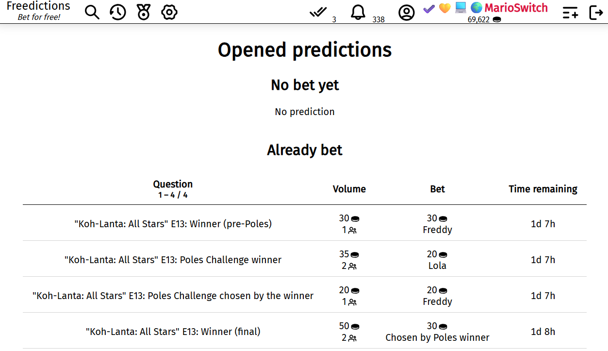
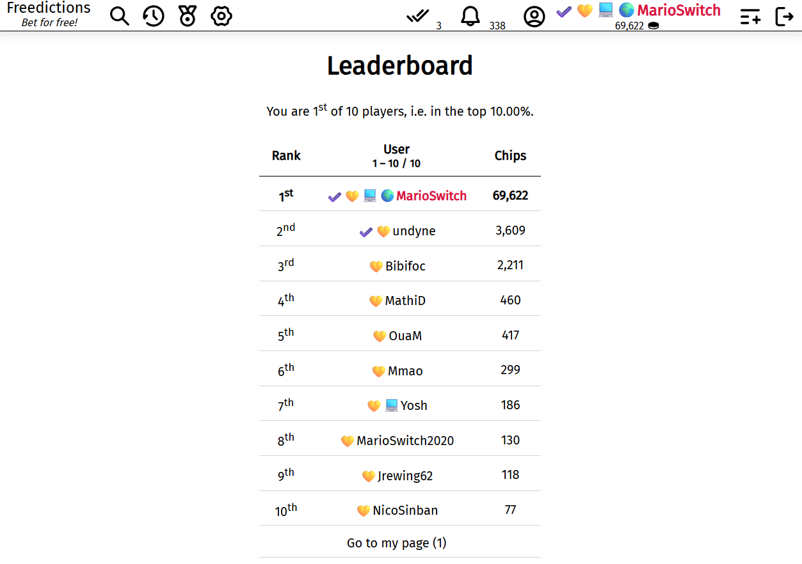
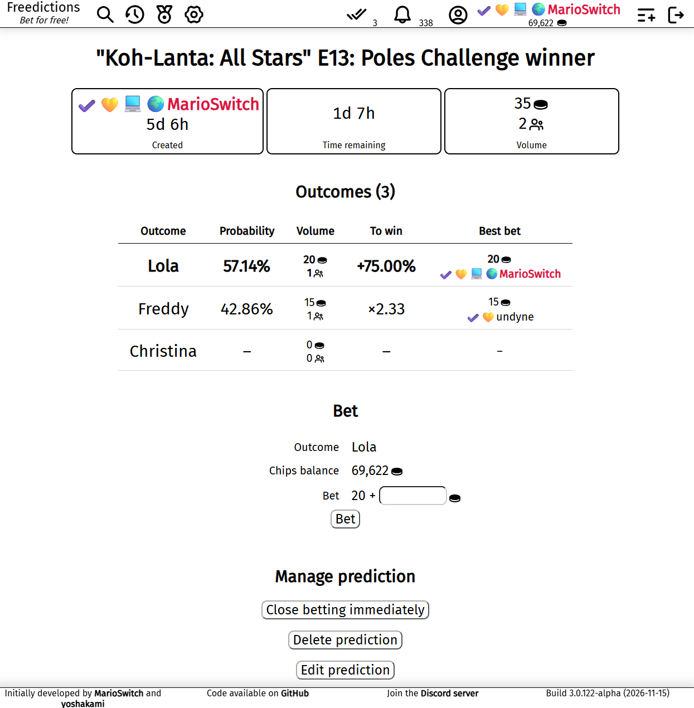
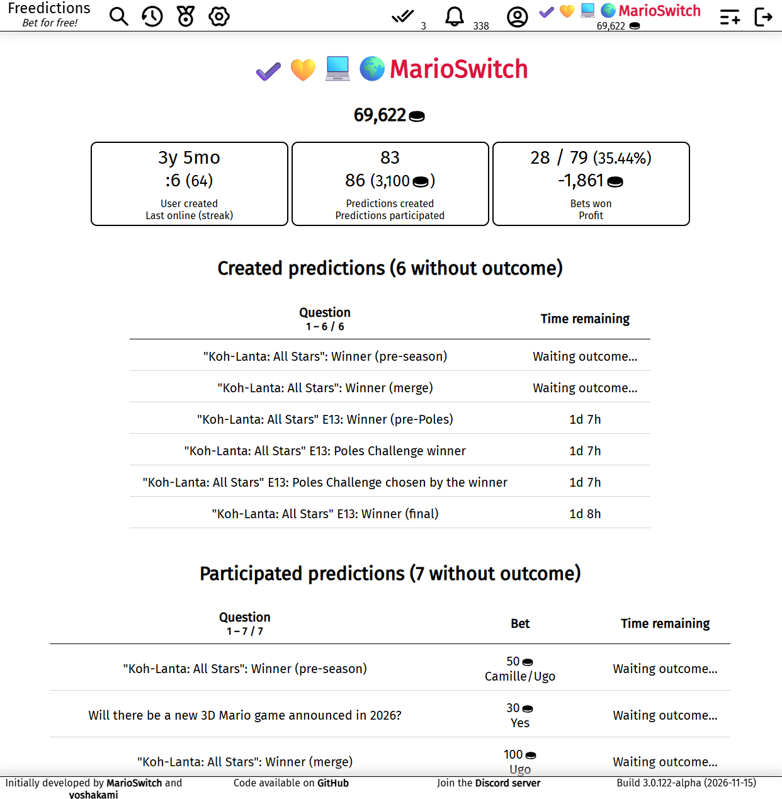

# Freedictions
**Freedictions** is a web engine where users can propose predictions (a question, some optional details, the list of possible outcomes and the end time) and bet on them with virtual chips.

When a prediction reaches its end time, a verifier can resolve it by selecting the correct outcome. Users that have bet on that outcome earn chips from all losers (and get back their own chips bet).

> [!NOTE]
> This engine does NOT propose any way to spend real money.

## License and attributions
**Freedictions** is free and open-source software (FOSS) and licensed under [*Creative Commons Attribution ShareAlike 4.0 (CC BY-SA 4.0)*](https://creativecommons.org/licenses/by-sa/4.0/).

Icons are from [**MingCute**](https://www.mingcute.com/), unchanged, and licensed under [*Apache License 2.0*](https://github.com/mingcute-design/mingcute-icons/blob/main/LICENSE).

[**Fira Sans**](https://fonts.google.com/specimen/Fira+Sans) font is from Carrois Apostrophe (available on Google Fonts), unchanged, and licensed under [*Open Font License (OFL)*](https://fonts.google.com/specimen/Fira+Sans/license).

## Localisation
**Freedictions** uses [**Weblate**](https://weblate.org/) as localisation software.

You can freely contribute to the localisation. If you are interested, please go to the [project's Weblate page](https://hosted.weblate.org/projects/freedictions/) to have additional information.

Current localisation progress (all languages):

### Available languages
Languages below are open for translation. If you want to translate **Freedictions** to a new language, please open an issue [here](https://github.com/MarioSwitch/Freedictions/issues/new).

## Learn more
Please go to ``docs/`` for more information about the project.

## Gallery

